# AWS RDS PostgreSQL Provisioning, Security Hardening & Disaster Recovery (Day 26)

A production-ready reference guide for provisioning a secure, private Amazon RDS PostgreSQL database inside a custom AWS VPC architecture, configuring application-level security groups, executing SSL/TLS encrypted database operations via `psql`, implementing manual point-in-time snapshot and restoration workflows, and executing automated resource teardown.

---

## Table of Contents
- [Project Architecture & Services Used](#project-architecture--services-used)
- [Prerequisites & Setup](#prerequisites--setup)
- [Step-by-Step Implementation Guide](#step-by-step-implementation-guide)
  - [Step 1: Configure VPC Security Groups](#step-1-configure-vpc-security-groups)
  - [Step 2: Provision DB Subnet Group and RDS Instance](#step-2-provision-db-subnet-group-and-rds-instance)
  - [Step 3: Install PostgreSQL Client and Establish SSL Connection](#step-3-install-postgresql-client-and-establish-ssl-connection)
  - [Step 4: Execute Database Schema Creation and Data Verification](#step-4-execute-database-schema-creation-and-data-verification)
  - [Step 5: Create Manual DB Snapshot and Verify Restoration](#step-5-create-manual-db-snapshot-and-verify-restoration)
  - [Step 6: Automated Resource Teardown & Cleanup](#step-6-automated-resource-teardown--cleanup)
- [Quick Reference Command Cheat Sheet](#quick-reference-command-cheat-sheet)
- [Troubleshooting & Common Challenges](#troubleshooting--common-challenges)
- [Security Best Practices & Hardening](#security-best-practices--hardening)
- [Learning Outcomes & Conclusion](#learning-outcomes--conclusion)

---

## Project Architecture & Services Used

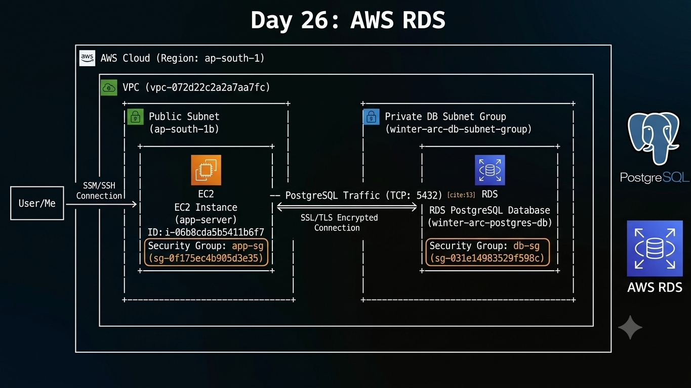

### Infrastructure Scope

| Service / Tool | Purpose | AWS / Infrastructure Scope |
| :--- | :--- | :--- |
| **Amazon RDS** | Managed relational database engine running PostgreSQL | Private DB instance deployment (`Publicly accessible: No`) |
| **Amazon EC2** | Application server node running Amazon Linux 2023 | Bastion host / application worker executing `psql` queries |
| **Security Groups** | Stateful network firewalls governing instance traffic | `app-sg` (App tier) & `db-sg` (DB tier ingress restricted to `app-sg`) |
| **DB Subnet Group** | Defines network boundaries and AZ availability for RDS | `winter-arc-db-subnet-group` referencing multi-AZ subnets |
| **AWS CLI** | Command-line management for automated operations | Initiating database snapshots, restoration, and teardown workflows |
| **PostgreSQL CLI (`psql`)** | Client tool for database administration | TLS-encrypted querying, DDL schema, and DML data insertion |

---

## Prerequisites & Setup

* **AWS Identity & Access Management (IAM):** Active AWS account with permissions for EC2, RDS, VPC, and IAM role assignment.
* **AWS CLI v2:** Installed and configured with region `ap-south-1`.
* **EC2 Instance:** Amazon Linux 2023 (`t3.micro`) running inside the target VPC.
* **Network Baseline:** Existing AWS Default VPC (`vpc-072d22c2a2a7aa7fc`) across multiple Availability Zones.

---

## Step-by-Step Implementation Guide

### Step 1: Configure VPC Security Groups

**What was done:**  
Created two isolated security groups: `app-sg` for the application tier and `db-sg` for the database tier. Inbound access to port `5432` on `db-sg` is restricted exclusively to traffic originating from `app-sg`.

**Commands executed:**
```bash
# 1. Create Application Security Group
aws ec2 create-security-group \
    --group-name app-sg \
    --description "Security group for EC2 application server" \
    --vpc-id vpc-072d22c2a2a7aa7fc \
    --region ap-south-1

# 2. Create Database Security Group
aws ec2 create-security-group \
    --group-name db-sg \
    --description "Security group for private RDS database" \
    --vpc-id vpc-072d22c2a2a7aa7fc \
    --region ap-south-1

# 3. Authorize TCP Port 5432 Inbound to db-sg from app-sg only
aws ec2 authorize-security-group-ingress \
    --group-id sg-031e14983529f598c \
    --protocol tcp \
    --port 5432 \
    --source-group sg-0f175ec4b905d3e35 \
    --region ap-south-1
```

**Purpose / Why:**  
Enforces standard multi-tier network segregation. Restricting database access to the app server security group prevents direct public internet exposure of sensitive database ports.

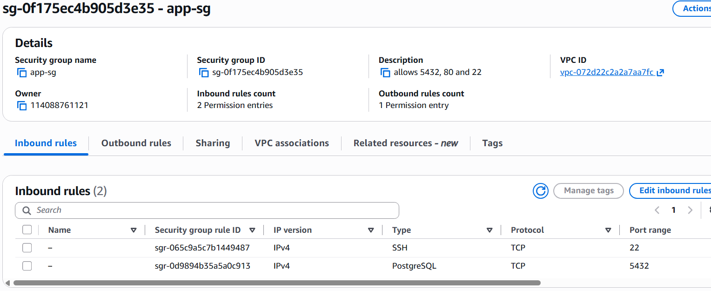
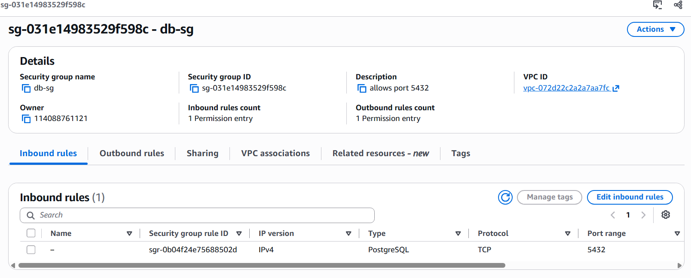
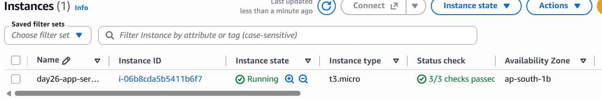

---

### Step 2: Provision DB Subnet Group and RDS Instance

**What was done:**  
Created a DB subnet group named `winter-arc-db-subnet-group` across multiple subnets. Provisioned a private PostgreSQL RDS instance (`winter-arc-postgres-db`) with `PubliclyAccessible=False`.

**Commands executed:**
```bash
# 1. Create DB Subnet Group
aws rds create-db-subnet-group \
    --db-subnet-group-name winter-arc-db-subnet-group \
    --db-subnet-group-description "DB subnet group for winter arc lab" \
    --subnet-ids subnet-0123456789abcdef0 subnet-0fedcba9876543210 \
    --region ap-south-1

# 2. Provision Private PostgreSQL RDS Instance
aws rds create-db-instance \
    --db-instance-identifier winter-arc-postgres-db \
    --allocated-storage 20 \
    --db-instance-class db.t3.micro \
    --engine postgres \
    --engine-version 18.3 \
    --master-username dbadmin \
    --master-user-password YourSecurePassword123! \
    --vpc-security-group-ids sg-031e14983529f598c \
    --db-subnet-group-name winter-arc-db-subnet-group \
    --no-publicly-accessible \
    --backup-retention-period 1 \
    --region ap-south-1
```

**Purpose / Why:**  
DB Subnet Groups ensure RDS instances can fail over across Availability Zones. Explicitly setting `--no-publicly-accessible` guarantees that the database is only reachable within the internal VPC CIDR block.

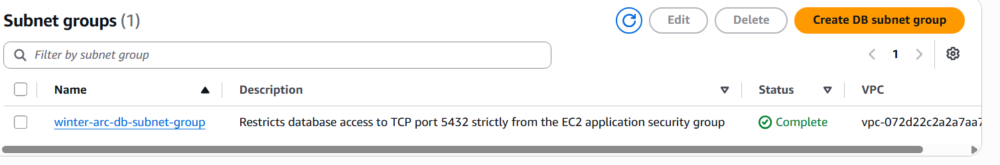
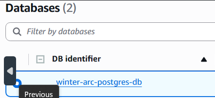

---

### Step 3: Install PostgreSQL Client and Establish SSL Connection

**What was done:**  
Connected to the `app-server` EC2 instance, installed the `postgresql15` client package, downloaded the official AWS Global Trust Store SSL root certificate bundle, and established a TLS-encrypted shell session to the database host.

**Commands executed:**
```bash
# Update repository package index and install PostgreSQL client
sudo dnf update -y
sudo dnf install postgresql15 -y

# Download AWS RDS global CA bundle for SSL verification
curl -o global-bundle.pem https://truststore.pki.rds.amazonaws.com/global/global-bundle.pem

# Export RDS Host endpoint variable
export RDSHOST="winter-arc-postgres-db.c1omwqymww9m.ap-south-1.rds.amazonaws.com"

# Connect via psql using verify-full SSL mode
psql "host=$RDSHOST port=5432 dbname=postgres user=dbadmin sslmode=verify-full sslrootcert=./global-bundle.pem"
```

**Purpose / Why:**  
Installing client tools enables database management without installing an entire database server daemon on the web node. Enforcing `sslmode=verify-full` with the RDS root certificate mitigates Man-in-the-Middle (MitM) attacks during transit over internal VPC links.

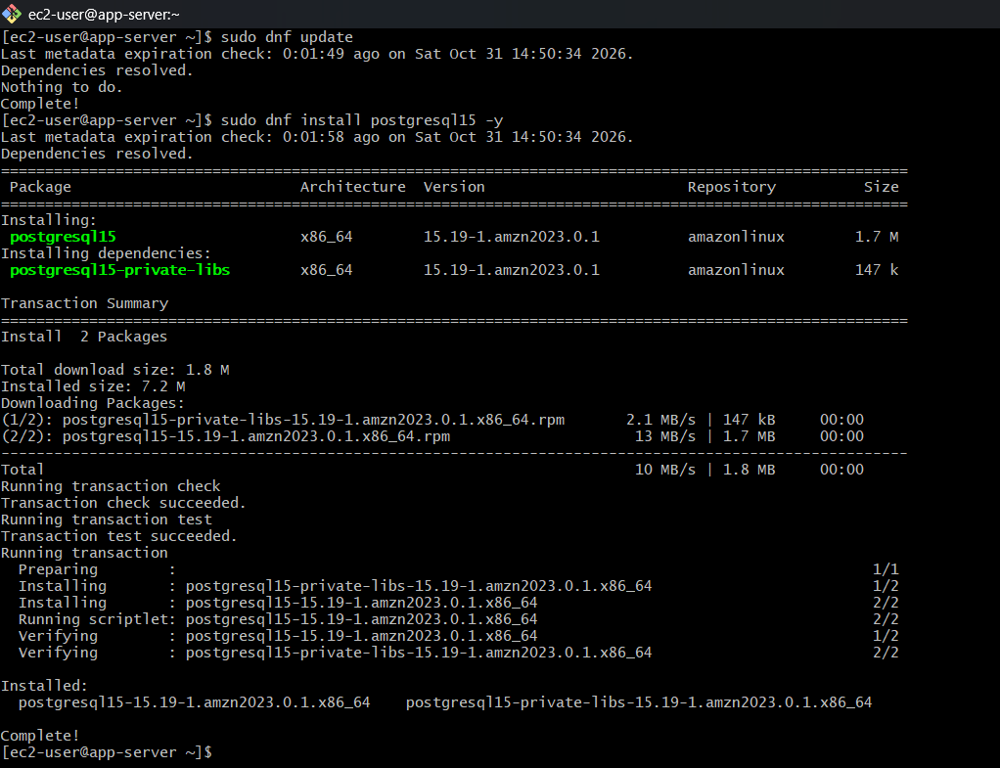
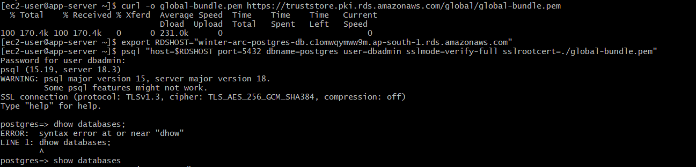

---

### Step 4: Execute Database Schema Creation and Data Verification

**What was done:**  
Created a custom database `winter_arc_db`, defined a `lab_notes` table with an auto-incrementing primary key and auto-generated timestamp, inserted verification records, and queried the state.

**Commands executed (inside `psql` shell):**
```sql
-- Create custom target database
CREATE DATABASE winter_arc_db;

-- Connect to newly created database
\c winter_arc_db;

-- Define production verification schema
CREATE TABLE lab_notes (
    id SERIAL PRIMARY KEY,
    note TEXT NOT NULL,
    created_at TIMESTAMP DEFAULT CURRENT_TIMESTAMP
);

-- Verify created relation table structure
\dt

-- Insert test verification row
INSERT INTO lab_notes (note)
VALUES ('Day 26 RDS connection test');

-- Query table for verification
SELECT id, note, created_at FROM lab_notes;
```

**Purpose / Why:**  
Confirms end-to-end write and read operations from the app server to the RDS storage engine, establishing operational baseline state prior to testing backup procedures.

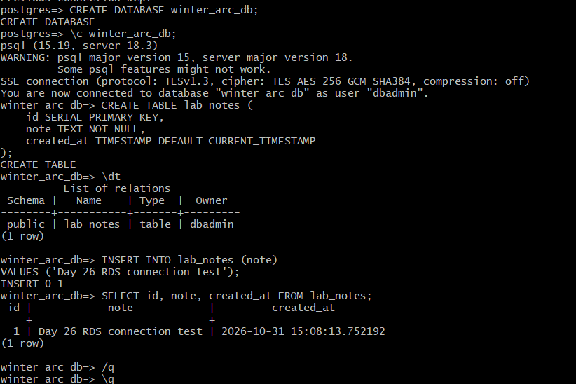

---

### Step 5: Create Manual DB Snapshot and Verify Restoration

**What was done:**  
Created a manual AWS RDS database snapshot named `day26-before-restore` using the AWS CLI, verified snapshot completion via the AWS Management Console, and tested point-in-time recovery.

**Commands executed:**
```bash
# Execute manual point-in-time database snapshot
aws rds create-db-snapshot \
    --db-instance-identifier winter-arc-postgres-db \
    --db-snapshot-identifier day26-before-restore \
    --region ap-south-1
```

**Purpose / Why:**  
Manual snapshots act as isolated points of data recovery before major software deployments or database migration runs.

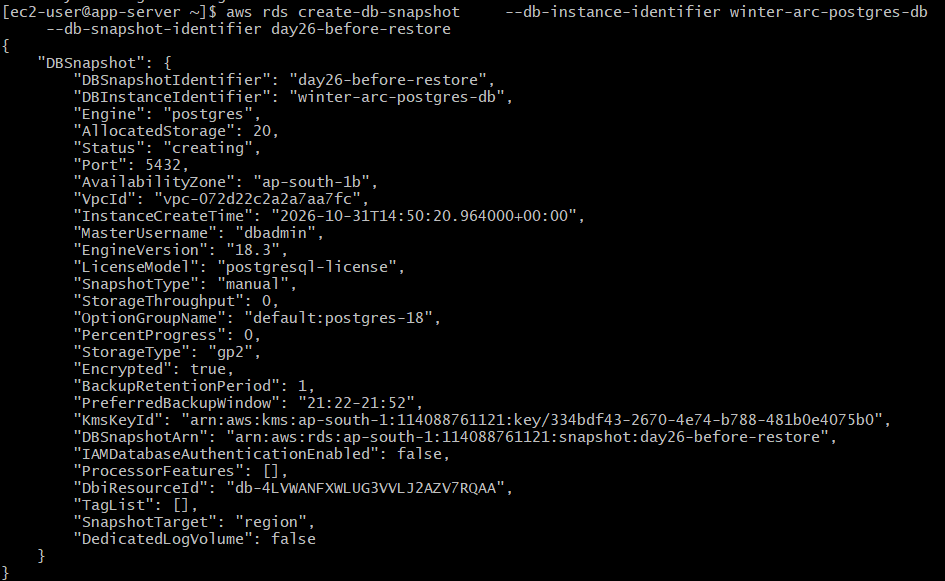
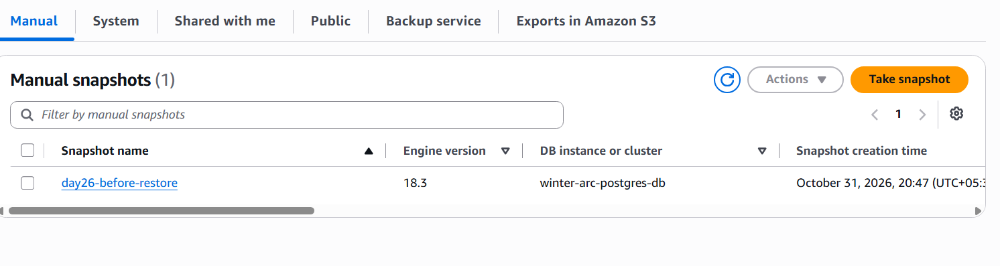

---

### Step 6: Automated Resource Teardown & Cleanup

**What was done:**  
Executed teardown commands to delete the primary RDS instance, restored RDS instance, and manual snapshots to prevent ongoing cloud billing charges.

**Commands executed:**
```bash
# Delete original and restored RDS instances without final snapshots
aws rds delete-db-instance \
    --db-instance-identifier winter-arc-postgres-db \
    --skip-final-snapshot

aws rds delete-db-instance \
    --db-instance-identifier winter-arc-postgres-restored \
    --skip-final-snapshot

# Delete the manual snapshot
aws rds delete-db-snapshot \
    --db-snapshot-identifier day26-before-restore
```

**Purpose / Why:**  
Proper resource cleanup prevents orphaned cloud artifacts and ongoing hourly fees for idle managed databases.

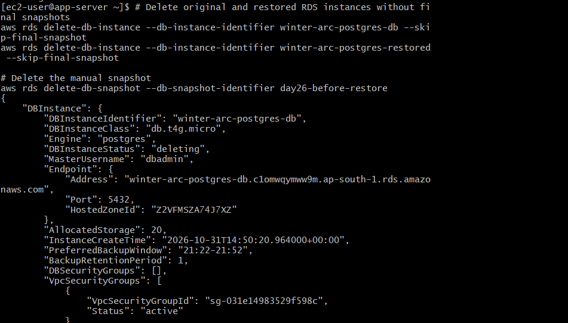
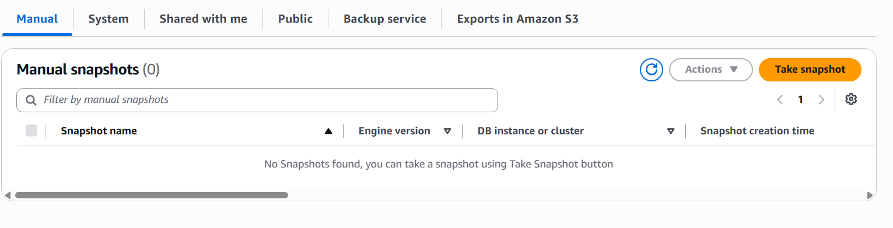
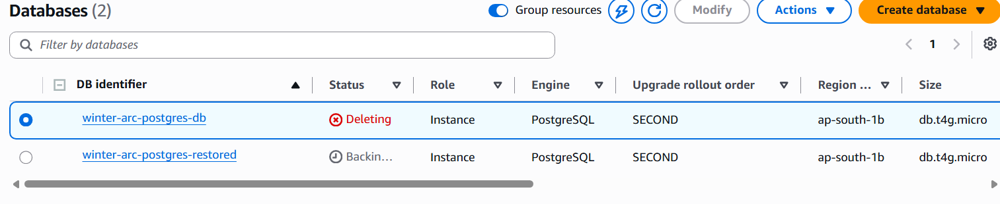

---

## Quick Reference Command Cheat Sheet

```bash
# -------------------------------------------------------------------
# 1. EC2 & AWS CLI PREPARATION
# -------------------------------------------------------------------
export AWS_DEFAULT_REGION="ap-south-1"
export RDSHOST="winter-arc-postgres-db.c1omwqymww9m.ap-south-1.rds.amazonaws.com"

# 2. INSTALLATION & CERTIFICATES
sudo dnf install postgresql15 -y
curl -o global-bundle.pem https://truststore.pki.rds.amazonaws.com/global/global-bundle.pem

# 3. POSTGRESQL CONNECTIVITY & QUERYING
psql "host=$RDSHOST port=5432 dbname=postgres user=dbadmin sslmode=verify-full sslrootcert=./global-bundle.pem"

# -------------------------------------------------------------------
# 4. SQL EXECUTION IN PSQL
# -------------------------------------------------------------------
-- CREATE DATABASE winter_arc_db;
-- \c winter_arc_db;
-- CREATE TABLE lab_notes (id SERIAL PRIMARY KEY, note TEXT NOT NULL, created_at TIMESTAMP DEFAULT CURRENT_TIMESTAMP);
-- INSERT INTO lab_notes (note) VALUES ('Day 26 RDS connection test');
-- SELECT * FROM lab_notes;
-- \q

# -------------------------------------------------------------------
# 5. DISASTER RECOVERY & CLEANUP VIA AWS CLI
# -------------------------------------------------------------------
# Create DB Snapshot
aws rds create-db-snapshot --db-instance-identifier winter-arc-postgres-db --db-snapshot-identifier day26-before-restore

# Restore Instance from Snapshot
aws rds restore-db-instance-from-db-snapshot --db-instance-identifier winter-arc-postgres-restored --db-snapshot-identifier day26-before-restore --db-subnet-group-name winter-arc-db-subnet-group --vpc-security-group-ids sg-031e14983529f598c

# Teardown Instances
aws rds delete-db-instance --db-instance-identifier winter-arc-postgres-db --skip-final-snapshot
aws rds delete-db-instance --db-instance-identifier winter-arc-postgres-restored --skip-final-snapshot
aws rds delete-db-snapshot --db-snapshot-identifier day26-before-restore
```

---

## Troubleshooting & Common Challenges

### Issue 1: Connection Timeout (`psql: error: Connection timed out`)
* **Root Cause:** Inbound security group rules on `db-sg` are missing TCP Port 5432, or `Publicly Accessible` is set to false and connection is attempted from outside the VPC.
* **Resolution:** Ensure connection is initiated inside the `app-server` EC2 instance and verify `db-sg` allows ingress on port 5432 from `app-sg`.

### Issue 2: AWS CLI Credentials Missing (`NoCredentials: Unable to locate credentials`)
* **Root Cause:** AWS CLI executed on EC2 without an IAM role attached or access keys set in local shell environment.
* **Resolution:** Attach an IAM Role with `AmazonRDSFullAccess` to the EC2 instance via AWS Management Console -> EC2 -> Actions -> Security -> Modify IAM Role.

### Issue 3: PostgreSQL Syntax Errors (`ERROR: syntax error at or near "dhow"`)
* **Root Cause:** Attempting MySQL-specific commands (e.g., `SHOW DATABASES;` or `USE database;`) inside a `psql` prompt.
* **Resolution:** Use native PostgreSQL meta-commands: `\l` to list databases, `\c <dbname>` to connect/switch databases, and `\dt` to display tables.

---

## Security Best Practices & Hardening

* **Eliminate Public Access:** Set `--no-publicly-accessible` on all production databases to force access exclusively through private subnet endpoints.
* **Security Group Referencing:** Avoid hardcoding specific IP addresses in database inbound rules; reference source security group IDs (`app-sg`) dynamically.
* **Enforce TLS In-Transit Encryption:** Always connect using `sslmode=verify-full` with updated trust store certificate bundles (`global-bundle.pem`).
* **Adopt AWS SSM Session Manager:** Remove SSH inbound rules (Port 22) from EC2 security groups and manage EC2 instances using SSM IAM profiles for keyless access.
* **Storage Encryption at Rest:** Enable AWS KMS managed key encryption (`--storage-encrypted`) for underlying DB block storage.

---

## Learning Outcomes & Conclusion

* **Private Database Topology:** Configured secure AWS relational database architectures isolated from the public internet.
* **Security Isolation:** Enforced least-privilege network access rules by connecting application security groups directly to database security groups.
* **Database Administration:** Mastered PostgreSQL client commands (`psql`), table creation, dynamic queries, and schema listing.
* **Disaster Recovery Management:** Executed point-in-time manual backups and verified data recovery workflows using snapshot restoration.